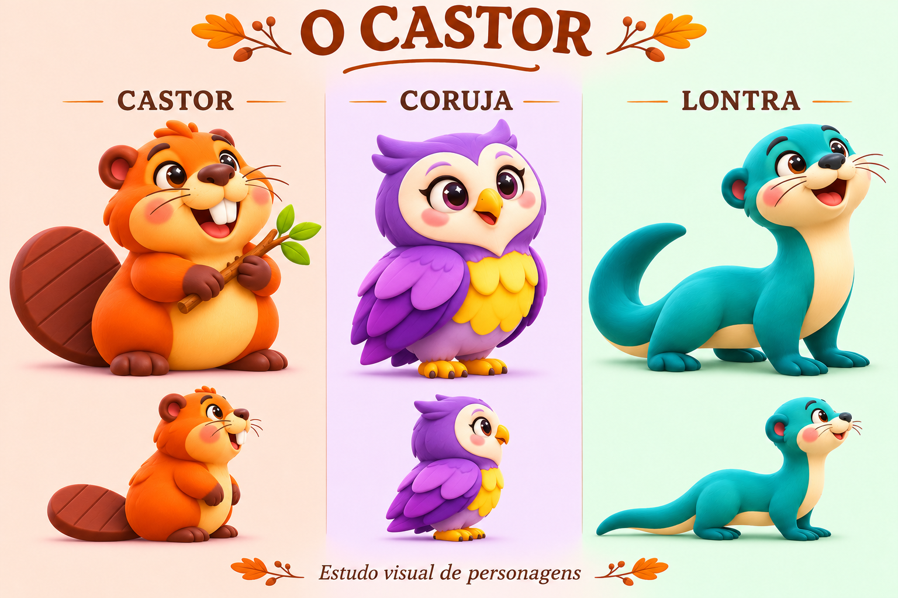
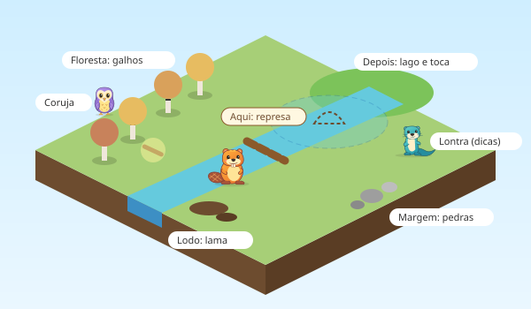
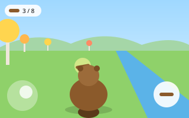
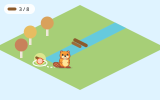
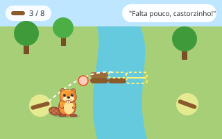
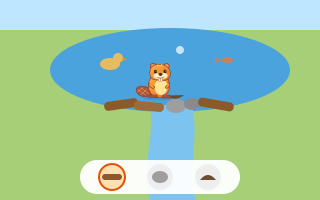
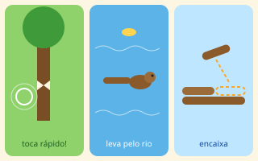
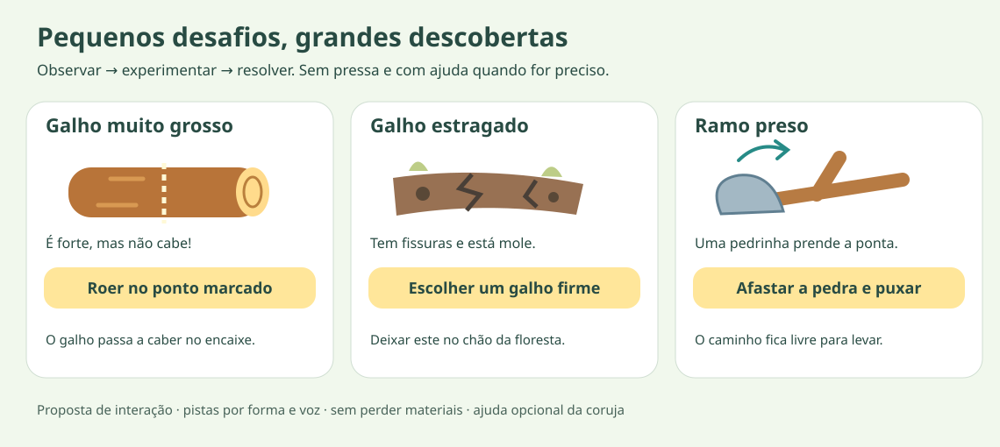

# Brainstorm summary: O Castor

> This is the main summary and shows the current version (v3) of the drawings. The full analysis, the risks, the proposed first path and the version history are in [review-and-visual-direction.md](review-and-visual-direction.md).

> Planning for the first family MVP: [overall roadmap and development stages](roadmap.md). The first goal is for the author's 6-year-old daughter to play the chapter; the priority device will be chosen between PC and Android after a hands-on trial.

> To get started: [startup plan](startup-plan.md). Production of the [3D characters](roadmaps/3d-characters.md) and [3D environment](roadmaps/3d-environment.md) follows the playable milestones, with assets and sources recorded in the [production inventory](3d-production.md).

## Context

Planning note: the [roadmap review](roadmap-review.md) records later adjustments to the proposals below, including splitting the dam into 3a/3b, early animation testing, simplified help and an audio script. To execute, follow the updated roadmap; this summary preserves the origin of the ideas.

The initial idea:

> A children's game for kids aged 6 to 10, divided into levels. In each level the child is an animal and has to complete tasks to finish the level. For example, they are a beaver and have to collect materials to build the dam and then the home on the lake. The narrative is a children's tale.

The game has to run on **Android and desktop**.

## The moment we want to create

> "Pai, olha, fiz uma represa! O que mais posso fazer?" ("Dad, look, I made a dam! What else can I do?")

What this sentence tells us:

- **"Pai, olha"** ("Dad, look"): she plays with her dad nearby and wants to show what she made. The game is for sharing.
- **"fiz uma represa"** ("I made a dam"): the pride comes from something she built that stays visible in the world, not from a score.
- **"o que mais posso fazer"** ("what else can I do"): finishing a task opens curiosity instead of closing it. A level should never end with a dry "Level complete".

## Decisions made

| Topic | Decision |
|---|---|
| Audience | Children aged 6 to 10 |
| Platforms | Android and desktop |
| MVP | Only the beaver chapter |
| Structure | Each animal is a chapter with several stages |
| Beaver stages | 1. Build the dam. 2. Build the home. 3. Store food |
| Other animals | Unlocked over time (outside the MVP) |
| World | 3D and open: the beaver walks freely around a small valley |
| Narrative | A children's tale linking the stages |
| Challenges | Small obstacles solved by observing and choosing, such as thick or rotten branches. No timer and no losing materials |
| Characters | Bright colors and rounded shapes, with child appeal (v3 direction) |

## The chapter's story (proposal)

The three stages are inspired by a beaver's autumn: first the dam, then the lodge and, finally, the food store for winter. In nature, that store is branches kept underwater next to the lodge, not a pantry like in a house. The thread of the story is **getting ready for winter**. Each stage leaves the valley a little more ready, and the chapter ends with the first snow falling, the beaver sheltered and the family together.

Beavers do not hibernate and stay active in winter, so the ending should not suggest that the beaver will sleep until spring. The order of the three stages is a story choice and not a rule of nature. The animals talking is also a liberty of the tale.

That way, the end of the level is a moment in the story and not a score screen. Along the way, the child learns how the animal really lives, without it feeling like a lesson.

## The characters

| Animal | Role | Personality |
|---|---|---|
| Beaver (orange and honey) | The character the child controls | Curious and persevering |
| Owl (lilac and yellow) | Gives hints when the child asks for them, pointing at something in the world | Attentive and calm |
| Otter (turquoise and cream) | Celebrates the formation of the lake; can use a static pose or simple movement in the MVP | Playful and adventurous |

The colors are a liberty of the tale, not the real colors of these animals. Each species has to be recognizable by shape alone, even when small in the diorama: the beaver's wide, flat tail and the otter's long, tapered tail. The image is an artistic reference and not a 3D model. The editable vector version is in [characters-v3.svg](mockups/characters-v3.svg).

The originally proposed role of the otter demonstrating actions remains a future possibility. In the MVP, the owl helps and the otter celebrates; it is not necessary to produce demonstrations or a dedicated otter rig to move from 3b to the chapter.

## The valley

Proposal, still to be validated:

- A small valley that can be crossed in less than a minute. She doesn't get lost, but feels she is exploring.
- Map proposal: **branches** in the autumn forest, **stones** on the bank and **mud** in the silt. Milestone 2 tests only branches; whether stones and mud are included as building materials in the MVP, and their role, will be decided before 3a. Decorative stones do not imply collectible stones.
- The dam sits in the middle of the river. The lake and the lodge appear dashed while they don't exist and take shape as she builds.
- The owl gives hints and the otter celebrates the formation of the lake in 3b. The animals' small requests, originally proposed, are left for after the MVP.
- What she builds stays in the world: the home is born in the lake that the dam created.

## Camera (to be decided)

| Third person | Diorama |
|---|---|
|  |  |
| The camera stays behind the beaver. On Android it is controlled with an on-screen joystick and an action button; on desktop, with the arrow keys or WASD. It is more immersive, but hard for a 6-year-old. | Top-down, tilted view. She taps a spot and the beaver goes there, as in Animal Crossing or Tiny Glade. It works the same with a finger and with a mouse. |

**Recommendation:** diorama. It is easier for this age and the controls are the same on Android and desktop. Still, it is a hypothesis to confirm in a prototype, not a decision.

## How the dam is built (to be decided)

| A: Collect and fit | B: Free build | C: Mini-games |
|---|---|---|
|  |  |  |
| Branches glow around the world. She taps a branch to pick it up and taps the slot to put it in the dam (dragging is optional). It is guided and impossible to fail. | She chooses branch, stone or mud and puts it wherever she wants. The water rises, the lake forms and ducks and fish appear. The dam looks the way she made it. | Each branch goes through three short moments: gnaw the tree, carry it down the river and fit it. It has more action, but is more work to make and can be tiring. If it goes ahead, the "toca rápido!" ("tap fast!") has to give way to an unhurried action. |

**Recommendation:** mix A and B, in an assisted build. The dam's structure has a building zone and wide slots, so it is predictable. The finishing is chosen by her. Each branch placed changes the water right away: the current slows, a pool forms and, finally, the lake. That way, each trip has a visible consequence and the "fiz uma represa" ("I made a dam") is truly hers.

**Reading the mockups:** `3 / 8` is a visual example, not a decision to use eight materials nor an obligation to show a numeric counter. Test how progress is presented in 3a. The stone/mud zones on the map represent candidates still to be decided for the MVP. See [mockup status](mockups/README.md).

## Small obstacles

The challenge lies in observing and choosing an action: the child sees a problem, tries something and sees the solution in the world.

| Obstacle | How it is recognized | What the child does |
|---|---|---|
| **Branch too thick** | The tip is visibly bigger than the slot | Tells the beaver to gnaw the tip, or picks a thinner branch |
| **Rotten branch** | It has cracks and holes, and bends when she examines it (it is not recognized by color alone) | Leaves it on the ground and picks a firm branch. If she has already carried it to the dam, she can swap it right there |
| **Stuck branch** (next) | The tip is stuck under a small stone | Moves the stone away and then pulls the branch |

- The first test of milestone 2 uses only normal branches. The thick and the rotten branch come in 3a, after validating the main interaction.
- Obstacles appear gradually and never two on the same branch.
- There are no dead ends: there is always a good material nearby.
- Help comes in stages. First the beaver reacts. After two attempts without progress, the owl offers a hint, and there is always a help button.
- In the game, actions appear as large icons with narration. The text buttons on the board are only there to explain the idea.

## Common principles (proposals)

- A narrator reads the story aloud, because at 6 children still read little.
- There is never a "you lost". At most, the beaver trips and laughs.
- Everything she builds stays in the valley and can be revisited, even after the first snow.
- Progress is saved after each placement.
- She can experiment, undo and correct without losing materials.

## Tools (to be chosen)

Android and desktop is a different requirement from the Cantar game, which ran only in the browser. Options:

- **Godot:** free, lightweight and exports to Android and desktop. Uses C# or GDScript.
- **Unity:** uses C# and is widely used, but is heavier.
- **Packaged Three.js** (for example with Capacitor for Android and Electron for desktop): reuses JavaScript, but there are two packagings to maintain.

Before choosing, it is worth making a small prototype on Android to test the essentials: tap to move the beaver, pick up a branch and place it in the dam.

## Open questions

- Which camera: third person or diorama?
- Which way of building the dam: A, B, C or a mix?
- Is the valley the right size, or does she expect a bigger world?
- What are the home and food stages like?
- Do the other animals share the same world or does each have its own?
- How long does the beaver chapter last?
- Which game engine to use?
- Who voices the narrator?
- Which region and which species serve as reference before making the 3D models?
