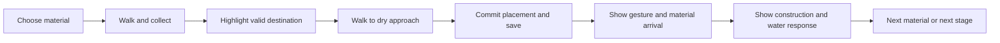

# Castor — construction and valley polish

Date: 10 November 2026. Status: direction agreed; detailed behaviour below is a proposal for implementation and playtesting, not an implemented or validated result.

[Roadmap](roadmap.md) · [Milestone 4b](roadmaps/04b-visual-valley.md) · [Implementation plan](construction-polish-plan.md)

## Intent and decision

Make the existing chapter communicate: **I collected this material, built something with it, and changed the valley.** The audience remains the author's six-year-old daughter, with her dad nearby. Success is her understanding and enjoyment of the actions, not the number of assets or activities.

The author agreed to prioritize clear guidance, satisfying construction, the river and scene composition, then vegetation. This is a bounded refinement of milestones 4b and 5. It does not add a milestone or close the outstanding human/device checks.

| Approach considered | Benefit | Tradeoff and decision |
|---|---|---|
| Add activities, materials or destinations | More things to do | Expands the chapter before its existing interactions have been observed with the child; deferred |
| Produce more tree models first | More visual variety | Does not resolve competing messages or the connection between building and water; deferred |
| Polish one complete construction sequence, then extend it | Improves the core action and provides a small playable comparison | Requires coordinating existing UI, animation and world feedback; selected direction |

The durations, cue treatment and finish-panel behaviour in this document are proposed starting points. They were not individually approved by the author. Keep them easy to adjust after observation.

## Evidence and current limitations

The author's screenshot shows the food objective, the dam finish options, the completed-home message and the food invitation together. Their simultaneous presence makes the current task less clear. Several rings also compete with the beaver and the destination. The broad shadows, sparse vegetation and angular light-coloured lodge pieces contribute to a provisional appearance.

The current implementation already has collection and placement sounds, `PrototypeActor.play_place_action()`, a 0.45-second branch flight, a 0.7-second water rise, ripples, dam growth, home slots, food storage and a winter ending. These features need coordination and visual review, not replacement with a new construction system. Home pieces currently move directly to their final transforms.

The dam approach is separated from the structure. The upstream water reaches its full prepared level after the second branch; the third completes the structure without another rise. That final action needs a readable completion response, not an arbitrary extra flood.

These observations come from the screenshot, project notes and source inspection. They do not establish whether the child understands or enjoys the current game. Existing automated results are recorded in [startup progress](startup-progress.md); this proposal claims no new execution evidence.

## Constraints

- Godot 4.7.2, typed GDScript, Compatibility renderer.
- One valley; dam → home → food → winter; existing counts, stable IDs, material suitability and saved finish choices remain intact.
- Tap/click to collect and place; no mandatory reading, dragging, precise rotation or manual camera control.
- Prepared water states; no physical water simulation or swimming.
- English developer documentation, code and logs; European Portuguese child-facing text and voice.
- Editable art sources in `art/`; exported resources in `game/`; third-party provenance in `3d-production.md`.
- Preserve existing saves and protected restart; presentation timers and animation state are not saved.
- No global tool/settings changes. Commit only when the author asks.

## The intended short experience

1. The child sees the beaver, a small collection area and one current objective. Available branches have quiet, consistent pickup cues.
2. Tapping a branch gives immediate acknowledgement and sends the beaver to it. Tapping another reachable branch changes the intention using the existing rules.
3. When the beaver carries a suitable branch, the destination becomes the strongest cue. Other materials stay available but visually quieter. An unsuitable branch keeps its existing corrective help.
4. Tapping the destination sends the beaver to a dry work position. The destination marker identifies the structure; a separate movement marker may show where the beaver stands.
5. On arrival, a short gesture and material movement show the placement. The impact sound, visible construction gain and water response follow the arrival of the material.
6. The changed structure remains visible after the effects disappear. After the last branch, a brief celebration leads into the home objective. The child can continue without dismissing a modal message.

The save happens when placement is accepted at the work position. Animation presents that committed result. Closing during an effect must restore the finished placement without duplication or replaying celebrations.

## Guidance and screen composition

Use one compact objective/progress region, one contextual help control and a temporary message/subtitle region. Keep the central action visible. Retain the title's adult restart gesture when changing its size or layout.

| Context | Primary child-facing copy | Visual treatment |
|---|---|---|
| Dam, empty paws | “Escolhe um ramo para a represa.” | Quiet branch cues; current-stage progress only |
| Dam, suitable branch carried | “Leva o ramo até à represa.” | Placement silhouette or broken outline at the dam; pickup cues subdued |
| Home, empty paws | “Escolhe uma peça para a casa.” | Available parts and unfinished lodge positions |
| Home, piece carried | “Leva a peça até à casa.” | Empty build positions emphasized; filled positions quiet |
| Food, empty paws | “Escolhe um feixe de comida.” | Suitable collection area and current food progress |
| Food, suitable bundle carried | “Guarda o feixe junto à casa.” | Cache destination emphasized; dry approach distinct from storage location |
| Completion | “A represa está pronta!”, “A casa está pronta!” or “A comida está guardada!” | One short celebration, followed by the next objective |

The exact copy above is a proposed baseline. Preserve the existing obstacle-specific instructions and help. A short action acknowledgement may replace the objective while walking; old invitations must not remain as additional permanent instructions.

Proposed celebration duration: **2.0 seconds**. A new meaningful action dismisses it early. A newer completion replaces an older one. No timer may clear a newer message. Save-failure feedback takes priority and retains its existing recovery behaviour; a celebration must never hide it.

A spoken line may have a matching subtitle. Sequence completion and invitation voice lines rather than playing both at once. Explicit help or a new action cancels obsolete guidance. Loading a save restores the current objective without replaying completion narration. Do not require audio to locate the next action.

Use both shape and emphasis to distinguish pickup from placement: a quiet closed pickup ring versus a broken destination outline or material silhouette. Colour alone must not carry the distinction. Avoid permanent pulsing on every object; animate the current destination or a requested hint. Do not make buttons smaller simply to reduce clutter. Review layout and touch targets at the actual device size.

## Dam finish choice

Keep both existing finishes and allow later changes. After the dam celebration, briefly present the choice as a compact optional panel; it must not prevent starting the home. Selecting a finish or starting another action closes the panel. A “Fechar” control also closes it without selecting.

Tapping the completed dam reopens the panel, including during the home, food and winter visit. Use the visible dam as the target, not only the old bank ring. Opening or closing this panel must not discard a carried item or issue a walking command. A choice keeps the existing save behaviour. Loading a save leaves the panel closed and restores the saved accent. A finish remains optional; an unset finish must not block progression.

## Construction and water feedback

- Reuse the beaver's existing gesture first. Add no new rig or animation catalogue for this increment.
- Start with the existing **0.45-second** branch travel and **0.7-second** water rise. Time the impact sound and construction response to material arrival. Tune only after watching the complete sequence.
- Commit placement once at arrival of the beaver, persist immediately, and present the result once. Repeated taps cannot consume a second material or create a second completion.
- Keep movement and help responsive. After commitment, another movement request may interrupt the beaver's cosmetic gesture, but the material finishes at its committed destination and the essential world result appears. Leaving/reloading the scene cancels obsolete callbacks safely.
- Preserve upstream-only prepared water rise and the fixed downstream level. The final branch confirms the completed structure with sound, a brief ripple/spillway response and the existing celebration, even if the water level is already full.
- Test a closer dry dam approach using the shared terrain/layout/navigation. If no closer point has a safe route, keep the current approach and make the material's destination clear. Record that limitation rather than allowing walking on water.
- Extend the proven placement treatment to home pieces and food bundles without changing their suitability, counts or slot choices.

## Lodge, river and vegetation

**Lodge:** the player should recognize a rounded stick-and-mud shelter in the lake. Keep the two build positions and their choices, but make partial and complete states visibly different. Reduce straight plank/cabin dominance; do not show a finished-looking shell before the child places its parts. Keep the submerged entrance, bed clearance, dry approach and winter snow treatment. Judge it from the play camera as well as close up.

**River:** show a continuous channel, a dam crossing it and a calmer upstream pool. Use subtle downstream surface movement and gentler upstream movement, preserving the clipped shoreline and clear-water cache window. Water motion is decoration; static states must still explain the change. Avoid glare, dense foam and transparency that hide the food or targets. Improve bank transitions and soften distracting shadows while preserving terrain depth. Keep the accepted camera initially; consider a small framing adjustment only if comparisons show a specific occlusion or scale problem.

**Vegetation:** first compose small groups from existing trees, bushes, reeds and rocks. Vary their scale and rotation deterministically and keep collection clearings and walking routes open. Preserve a readable silhouette for the beaver and interactive materials. New tree models are a later optional response to a demonstrated silhouette gap, not a prerequisite for this pass.

## Delivery order and acceptance

| Increment | Observable result | Evidence |
|---|---|---|
| P1 — contextual guidance | Only the current task and temporary relevant feedback compete for attention | Fresh/restored chapter checks; transition captures; mouse/touch review |
| P2 — one satisfying dam action | Gesture, material, impact and water response form one understandable sequence | Short recording of first and final placement; cancellation/save regressions |
| P3 — child observation | Evidence about where she looks, what she tries and what she understands | Short session notes; no requirement to finish |
| P4 — home and food consistency | Both later stages communicate placement and visible progress | Partial/complete captures and full-chapter regression |
| P5 — river and lighting | Water and banks explain the valley transformation and keep targets readable | Same-camera before/after views; graphical and device checks |
| P6 — vegetation composition | The valley feels inhabited without hiding play | Full-valley comparison and route/touch review |

P1 and P2 are the first playable slice. Observe it before committing effort to broad art production. P4–P6 can be revised from that evidence; lack of child/device availability must be recorded, not counted as acceptance.

For a roughly 5–10 minute willing play session, initially avoid explaining controls; help if frustration appears. Note the device, starting save, first attempted action, mistaken targets, help given and spontaneous reactions. Observe whether she finds a material and its destination, recognizes a construction change and wants another turn. A natural prompt such as “O que mudou aqui?” can reveal understanding after the action; avoid giving the answer in the question. Stop if she wants to stop. This is a family MVP observation, not a population study.

If she is confused, adjust guidance and targets. If she understands but loses interest, inspect waiting time, repetition and visible consequences before adding activities. If she enjoys the chapter and asks for more, record what she wants to repeat or extend as evidence for future content.

## Completion boundary

This pass is ready for acceptance when current-stage guidance, consistent placement, visible world changes and the scene composition work together in the installed build; old saves and the complete chapter still work; and the author, child and priority-device observations are recorded with any remaining limitations. Automated tests and screenshots alone cannot close those gates. The roadmap's other outstanding checks remain in force.
