# O Castor — idea review and visual direction

Review of November 8, 2026, based on the brainstorm summary and the six original mockups. The recommendations below are proposals; they do not change the decisions in the original summary.

**v3 update:** at the user's request, light obstacles and characters with more color and child appeal were added. The specific solutions below are design proposals for that request.

**Production planning:** the [MVP roadmap](roadmap.md) and the [3D inventory](3d-production.md) organize the transition from these references to models, animations and environment usable in the game. The illustrations in this review remain 2D concepts; production starts with placeholder shapes and progresses gradually after testing the interaction.

## Assessment

For current execution, see the [handling of the roadmap review](roadmap-review.md): besides the simplified help, it makes explicit the materials to be decided before 3a, the otter in 3b, the deferred leak and secondary requests, and the illustrative nature of the counters. The passages below flag those changes next to the relevant proposals.

The idea has a clear emotional core: building something that transforms the world and wanting to show it to someone. The small valley, the preparation for winter and the three stages give an understandable beginning and end. Keeping only the beaver playable in the MVP is a good boundary.

The main risk is the game becoming a sequence of trips to fetch materials. The second is promising free building and ending up with slots where the child only follows instructions. The third is trying to develop three different games: exploration, water simulation and mini-games.

**Recommendation:** a small playable tale in diorama, with assisted building and visible decorative choices. The child should be able to point at a difference and say «fui eu que escolhi» ("I'm the one who chose it").

## Priority improvements

| Priority | Observation | Concrete proposal |
|---|---|---|
| High | Collecting and carrying can become repetitive. | The first placement already changes the current; a small set creates a pool; finishing the structure forms the lake. Each trip produces a consequence. |
| High | "Dragging each branch" may require unnecessary precision. | Tap the material to collect it and then the destination to fit it. Dragging is optional. Use an interaction area larger than the drawing. |
| High | Fully free building makes the water's behavior hard to predict. | Define a building zone and wide slots; let her choose the arrangement of the finishing elements. Use prepared water states, without requiring physics simulation in the MVP. |
| High | The three stages do not yet have distinct experiences. | Dam: fit pieces and watch the water. Shelter: choose and arrange parts. Food: recognize and store small bundles of branches. |
| Medium | "Never losing" does not guarantee interest. | Allow experimenting, undoing and correcting without losing resources. The small water leak is an expansion proposal for after the MVP, not part of the initial path. |
| Medium | The owl and the otter can turn into text boxes. | In the MVP, the owl points to a clue and the otter celebrates the formation of the lake, even in a static pose or with code-driven movement. The original proposal of demonstrations by the otter is left for future exploration. |
| Medium | The mockups depend on small text and glow. | Use repeatable voice, icon and interaction outline. Differentiate the destination by shape and animation, as well as by color. |
| Medium | The ending may prevent playing again. | After the first snow, allow revisiting the valley and showing the build, with a simple option to hide the interface. |

## Three possible approaches

1. **Guided slots:** simplest to explain and produce; gives little authorship if all choices are mandatory.
2. **Assisted building with customization — recommended proposal:** predictable structure and finishing chosen by the child. Balances clarity, personal expression and MVP scope.
3. **Free building with simulation:** offers discovery, but requires solving blockages, stability and water consequences. Reserve for later research.

I do not propose choosing a game engine yet. A small prototype with touch, automatic pathing, collecting and placing should first validate the experience on Android. The diorama camera remains a hypothesis to test, not an approved decision.

## Small obstacles that invite thinking

The challenge should lie in observing and choosing an action. The child finds a readable problem, tries something and sees the solution in the world. There is no timer, loss of resources or destruction of the build.

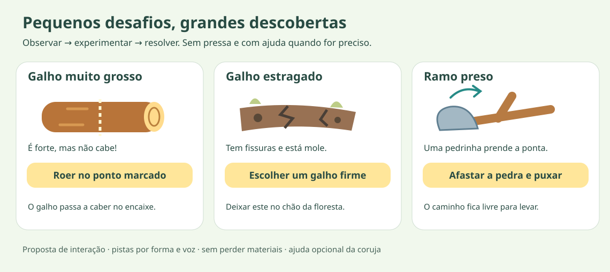

| Obstacle | How it is recognized | Child's action | Response and recovery |
|---|---|---|---|
| **Branch too thick** | The tip is visibly bigger than the slot; when brought close, it rests at the entrance. | Tap «Roer» ("Gnaw") at a marked point; the beaver trims the tip in a short animation. She can also choose a thinner branch. | The branch fits and slots in. It does not require tapping fast or hitting a small spot. |
| **Rotten branch** | Cracks, small holes and a tip that bends when inspected; it does not depend only on a dark color. | Inspect and choose a nearby firm branch. | The beaver comments «Este está mole. Vamos procurar um mais firme!» ("This one is soft. Let's look for a firmer one!"). If she has already carried it, she can swap it on the spot without repeating the whole trip; the rotten branch returns to the forest floor. |
| **Branch stuck under a stone** | The tip is visible under a small stone; when pulled, the branch moves but does not come out. | Tap the stone to move it away, then the branch. | The stone slides to a safe place and the branch is free. Two simple actions teach a sequence. |
| **Branch too long** — expansion | The tip goes beyond the available space. | Tap a large arrow to rotate or choose «Encurtar» ("Shorten"). | A preview shows the result; it is possible to undo before placing. |
| **Small water leak** — expansion | A trickle of water passes through a gap; soft sound and movement show where. | Choose mud to plug the gap. | The current slows. A different choice does not remove pieces or lower the whole lake. |

**Current prototype sequence:** normal branches in milestone 2; thick branch and rotten branch in 3a. Stuck branch and the remaining obstacles, including the leak, are left for after the MVP. They are prepared situations, not a random wear or physics system.

**Gradual introduction:** start with two usable branches and one successful placement. Then present a thick branch, on its own. Only later show two branches to compare firmness. In the first path, never combine several obstacles on the same object, and alternate challenges with simple actions.

**Help without solving it for the child right away:** on the first attempt, a short reaction from the beaver explains the problem; after two attempts without progress, the owl offers a hint the child can accept. A help button remains available and can demonstrate the solution. The voice can be repeated and is always accompanied by a visual clue.

**Avoiding dead ends:** keep a suitable material within reach, allow dropping and swapping a branch at any time, and also save the state of resolved obstacles. None of these challenges permanently blocks a stage. Touch areas cover the whole object, not just cracks or small marks.

**What to observe in the test:** does the child identify why the branch doesn't work, manage to try another action and feel satisfaction when she solves it? If she repeats the same attempt without understanding the reaction, improve the clue before increasing difficulty.

## Proposed first path

The times below are prototype hypotheses, not results of tests with children.

- **First minute:** see a branch and the building zone, collect and place; the current slows immediately. There is no leak to fix: that challenge is left for after the MVP.
- **Following minutes:** choose between two accessible materials and complete a small structure. Avoid a long initial list of ingredients.
- **First obstacle, after managing to build:** find a branch that is too thick, observe that it doesn't fit and gnaw the tip. Later, compare a firm branch with a rotten one. Do not put challenges in every pickup.
- **First reward:** the lake starts to form and the child chooses a finish for the dam in 3a, still with placeholder shapes. In 3b, the otter marks the new water; a static celebration pose or simple code-driven movement is enough, without requiring a swimming animation.
- **New curiosity:** a suitable spot for the shelter becomes accessible. The story invites her to continue, but progress is already saved.

For the full chapter, try sessions of 5–10 minutes per stage, with automatic saving after each placement. Adjust the duration after observing children at both ends of the age range.

## Nature and narrative

Clearly separate **dam**, **shelter** and **food store**. For a cold-climate valley, the store can consist of branches kept in the water next to the shelter; it does not need to look like a human pantry. This behavior is documented by [Montana Fish, Wildlife & Parks](https://fwp.mt.gov/conservation/living-with-wildlife/beavers).

The ending can show the beaver sheltered and the family together, but avoid suggesting hibernation: beavers stay active during winter. Reference: [Maine Department of Inland Fisheries & Wildlife](https://www.informe.org/ifw/fish-wildlife/wildlife/living-with-wildlife/avoid-resolve-conflict/beavers.html).

The animals talking is a storytelling license. The three-stage sequence is a narrative arrangement and should not be presented as a universal rule of nature. Before finalizing the 3D models, choose the reference region and species; the current studies are generic stylizations.

## New character direction

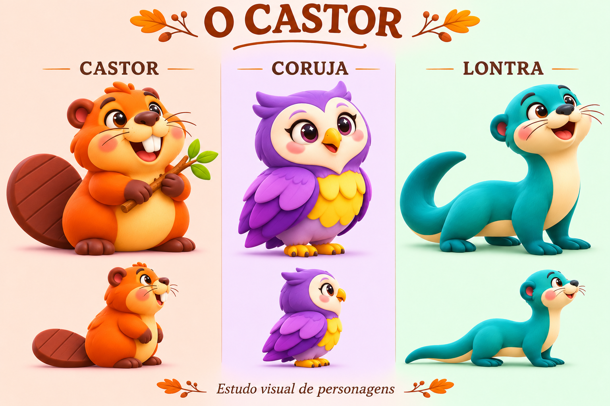

**Illustrated concept v3:** rounded shapes, expressive eyes, brighter colors and two views per animal. Orange and honey beaver; lilac owl with yellow; turquoise otter with cream. These fantasy colors are a visual license of the tale, not the real coloring of the species. The image is an artistic reference; it is not a 3D mesh nor a technical turnaround. Before modeling, reconcile proportions, poses and tails between views.

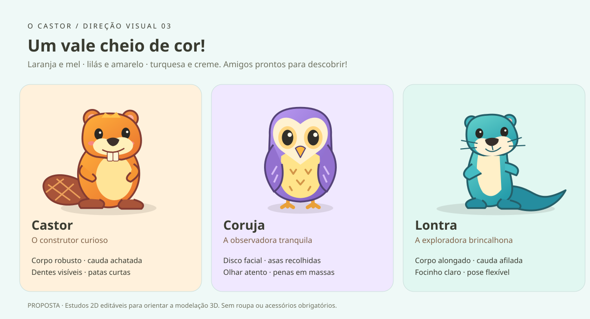

**Vector version:** an in-house simplification for the existing mockups. It keeps the main attributes of the concept, without trying to reproduce every fur detail. The otter stands more upright to make its expression readable; a future game version should also explore the low, elongated locomotion of the concept.

| Animal | Visual identity | Proposed personality | Animations to explore later |
|---|---|---|---|
| Beaver | Sturdy body, wide flat tail, two incisors, short legs. | Curious and persevering. | Walking with weight, carrying a branch, setting a branch in place, watching the water. |
| Owl | Compact vertical silhouette, light facial disc, wings closed in large masses. | Attentive and calm. | Blinking, tilting the head, pointing with the wing and landing. |
| Otter | Narrower, elongated torso, light throat, long tapered tail. | Playful and adventurous. | In the MVP, a celebration pose or simple movement. Sliding, swimming and peeking are optional future explorations. |

Do not depend on hats, clothes or different colors to distinguish the species. In the diorama, the beaver's tail and the otter's tail need to survive the reduction in scale. Whiskers, grooves and small feathers are secondary detail and may disappear at a distance.

Color reinforces personality, but identification still works through shape. Use backgrounds softer than the characters and reserve interaction highlights for outlines and movement. Do not make rotten branches recognizable only by a change of color.

## Updated mockups

The `3 / 8` counters are visual examples; they do not fix the number of materials nor the need for a counter in the MVP. How progress is presented will be tested in 3a. The stones and mud on the map are candidate building materials to be decided before 3a, separate from the decorative elements. See [mockup status](mockups/README.md).

The originals and the v2 versions were preserved. The v3 versions apply the child-friendly palette to the characters and make the water and vegetation more vivid. The obstacle board explains the new interactions; the four scenes below remain static studies and **do not implement** the game flow.

| Scene | Original | v3 version |
|---|---|---|
| Valley | 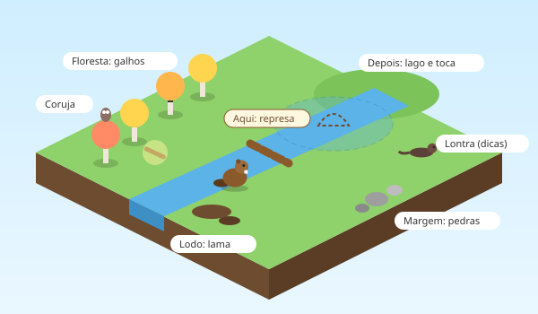 | 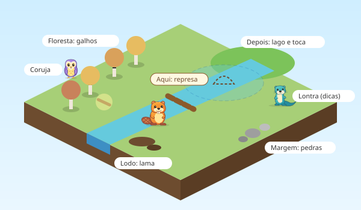 |
| Diorama | 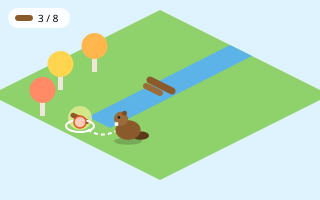 | 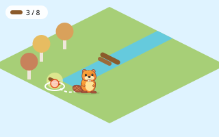 |
| Collect and fit | 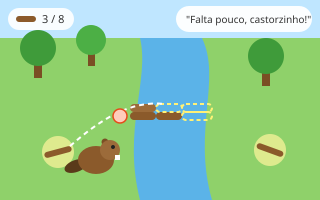 | 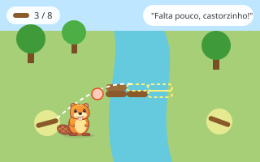 |
| Free build | 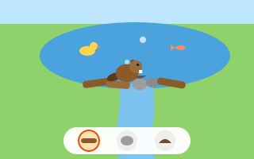 | 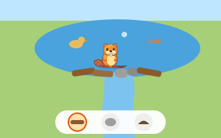 |

Third person and the mini-games panel remain as original alternatives. The text «toca rápido!» ("tap fast!") on the mini-games panel conflicts with the calm pace proposed; if that alternative goes ahead, replace it with an action without speed pressure.

## What to validate before producing the game

- Does the child tell the beaver and the otter apart in a small image, even without names?
- Does she discover how to collect and place the first branch without an adult explaining?
- Does she notice that her placement changed the water?
- Can she choose something that makes the build her own?
- When returning, does she recognize where she was and what she can do next?

Observe younger and older children separately. Success in this first test is understanding the action and wanting to continue; not meeting a time or achieving a score.

## Deliverables and reproduction

**Current version: v3.** Artistic board in `mockups/characters-concept-v3.png`, prompt in `mockups/prompt-characters-v3.md`, individual characters and four scenes with the `-v3.svg` suffix, board `mockups/characters-v3.svg` and study `mockups/obstacles-v3.svg`. Run `python docs/castor/mockups/generate_models_v3.py` to regenerate the SVGs from the v2 ones. The script keeps the v2 files and replaces only its own v3 files; it does not generate the artistic PNG.

**v2 history:**

- `mockups/characters-concept-v2.png`: artistic board generated with the built-in image tool.
- `mockups/beaver-model-v2.svg`, `owl-model-v2.svg`, `otter-model-v2.svg`: individual characters with transparent background.
- `mockups/characters-v2.svg`: editable comparison board.
- Four `*-v2.svg` scenes: integration in the context of the mockups.
- `mockups/generate_models.py`: source of the vector drawings and generator of the v2 copies; Python standard library only.
- `mockups/prompt-characters-v2.md`: prompt for the artistic board.

To regenerate the SVGs, run `python docs/castor/mockups/generate_models.py` from the project root. The v2 files are replaced; the originals are not changed. The concept PNG is not regenerated by the script.

These deliverables are 2D visual studies. They do not include Blender/GLB files, topology, rig, animation or performance validation on Android.
